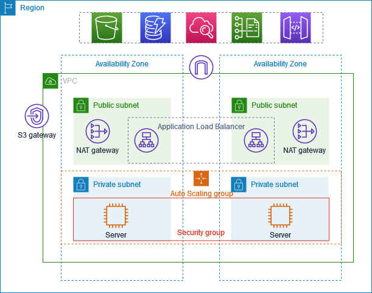

# AWS VPC: Private Subnets, NAT Gateways, Auto Scaling & Application Load Balancer

> Hands-on revision notes — Mumbai Region (`ap-south-1`)
>
> Based on the AWS tutorial: [Example: VPC with servers in private subnets and NAT](https://docs.aws.amazon.com/vpc/latest/userguide/vpc-example-private-subnets-nat.html)

## 1. What I built

I created a VPC using **VPC and more** with:

- 1 VPC
- 2 Availability Zones (AZs)
- 2 public subnets — one in each AZ
- 2 private subnets — one in each AZ
- 1 Internet Gateway (IGW)
- 2 NAT Gateways — one in each AZ
- Route tables for public and private subnet routing
- 1 Auto Scaling Group (ASG) with EC2 instances in private subnets
- 1 bastion host in a public subnet
- 1 internet-facing Application Load Balancer (ALB) in public subnets
- 1 target group forwarding traffic to the application on TCP port 8000

I did **not** create an S3 Gateway Endpoint in this exercise.

## 2. Architecture at a glance



The reference image shows the main layout: two AZs, public and private subnets, NAT Gateways, an Application Load Balancer, and EC2 servers managed by an Auto Scaling Group.

### Resource tree

```text
AWS Region: ap-south-1 (Mumbai)
└── VPC
    ├── Internet Gateway (IGW)
    │
    ├── Availability Zone A
    │   ├── Public Subnet A
    │   │   ├── NAT Gateway A + Elastic IP
    │   │   ├── ALB node
    │   │   └── Bastion EC2 (public IP)
    │   │
    │   └── Private Subnet A
    │       └── Auto Scaling EC2 instance(s)
    │
    ├── Availability Zone B
    │   ├── Public Subnet B
    │   │   ├── NAT Gateway B + Elastic IP
    │   │   └── ALB node
    │   │
    │   └── Private Subnet B
    │       └── Auto Scaling EC2 instance(s)
    │
    ├── Route tables
    │   ├── Main route table (local route by default)
    │   ├── Public route table (shared by public subnets)
    │   ├── Private route table A (via NAT Gateway A)
    │   └── Private route table B (via NAT Gateway B)
    │
    ├── Network ACLs (subnet level)
    └── Security Groups (stateful, attached to network interfaces/resources)

Application traffic:
Internet → Internet Gateway → Public ALB → Private EC2 targets
Private EC2 outbound internet:
Private EC2 → NAT Gateway in its AZ → Internet Gateway → Internet
```

> The bastion host is an administrative SSH entry point. It is separate from the application traffic path through the ALB.

## 3. Create and configure the VPC

### 3.1 Create VPC using VPC and more

In the VPC console:

1. Choose **Create VPC**.
2. Select **VPC and more**.
3. Choose 2 Availability Zones.
4. Choose 2 public subnets and 2 private subnets.
5. Choose **1 NAT Gateway per AZ**.
6. For this exercise, choose **None** for VPC endpoints if you do not want an S3 endpoint.
7. Create the VPC.

The two-AZ layout improves availability: resources can be placed in separate AZs rather than relying on one AZ.

### 3.2 DNS settings

I enabled:

- **DNS resolution** — instances in the VPC can use the Amazon-provided DNS resolver.
- **DNS hostnames** — instances with public IP addresses can receive public DNS hostnames, subject to the VPC and instance settings.

These settings are useful for name resolution and services that rely on DNS hostnames.

### 3.3 Internet Gateway

An Internet Gateway is attached to the VPC. It provides the VPC's connection to the internet when routing and public addressing are configured correctly.

An IGW attachment alone does **not** make every subnet public. A subnet is commonly called public when its associated route table has a default route to the IGW, and an instance also has a public IPv4 address (or another suitable public addressing arrangement).

## 4. Subnets and route tables

### 4.1 Example route table entries

For an IPv4 VPC CIDR of `10.0.0.0/16`, the important routes look like this.

**Public route table** — associated with both public subnets:

| Destination | Target | Purpose |
|---|---|---|
| `10.0.0.0/16` | `local` | Route within the VPC |
| `0.0.0.0/0` | Internet Gateway | Other IPv4 destinations via the internet |

**Private route table A** — associated with private subnet A:

| Destination | Target | Purpose |
|---|---|---|
| `10.0.0.0/16` | `local` | Route within the VPC |
| `0.0.0.0/0` | NAT Gateway A | Outbound IPv4 internet access |

**Private route table B** — associated with private subnet B:

| Destination | Target | Purpose |
|---|---|---|
| `10.0.0.0/16` | `local` | Route within the VPC |
| `0.0.0.0/0` | NAT Gateway B | Outbound IPv4 internet access |

**Main route table:** AWS creates a main route table for the VPC. It initially has the VPC's local route. Subnets that are not explicitly associated with another route table use the main route table.

### 4.2 How many route tables?

In the layout I observed, there were four route tables:

1. Main route table
2. Public route table shared by the two public subnets
3. Private route table A
4. Private route table B

The key concept is that **a subnet is associated with one route table at a time**, while one route table can be associated with multiple subnets. The main route table is the fallback for subnets without an explicit association.

The `local` route is what allows routing between IP ranges inside the VPC. The `0.0.0.0/0` route is the default route for IPv4 destinations not matched by a more specific route.

### 4.3 Why two NAT Gateways?

I selected **one NAT Gateway per AZ**. Each NAT Gateway is created in a public subnet and uses an Elastic IP.

The private subnet in AZ A routes its default IPv4 traffic through NAT Gateway A. The private subnet in AZ B routes through NAT Gateway B. This avoids making private-subnet internet egress depend on a NAT Gateway in only one AZ.

NAT Gateways are chargeable resources. Delete them after the lab and check for any remaining Elastic IP or public IPv4 charges.

## 5. Network ACLs and Security Groups

These are two different layers of network filtering.

| Feature | Network ACL (NACL) | Security Group (SG) |
|---|---|---|
| Applies to | Subnet boundary | Elastic network interface / associated resource |
| State | Stateless | Stateful |
| Rules | Allow and deny | Allow rules only |
| Rule evaluation | Numbered rules, lowest number first | All applicable rules are evaluated |
| Return traffic | Must be allowed explicitly | Automatically allowed for tracked connections |

### 5.1 Default NACL

The **default NACL** allows all inbound and outbound IPv4 traffic by default (and IPv6 rules where applicable). A newly created custom NACL normally starts with deny-all rules until rules are added.

Important correction: a subnet does not own a unique NACL exclusively. Every subnet is associated with exactly one NACL at a time, but one NACL can be associated with multiple subnets.

Because NACLs are stateless, allow the request and the return traffic. For TCP connections, return traffic commonly uses ephemeral ports. A rule that allows only the service port but blocks return traffic can break the connection.

### 5.2 Security Group rules for this lab

A useful least-privilege pattern is:

**Bastion Security Group**
- Inbound SSH (TCP 22) from **your own public IP address**, not from the whole internet if avoidable.
- Outbound traffic as required to reach private instances.

**ALB Security Group**
- Inbound HTTP (TCP 80) from the intended client range (for a public demo, this may be `0.0.0.0/0`).
- Outbound TCP 8000 to the application instances / their security group.

**Application EC2 Security Group**
- Inbound TCP 8000 **from the ALB security group**, not from every IP in the VPC.
- If SSH administration is required, allow TCP 22 from the bastion security group only.
- Do not add public SSH access to private application instances.

Security Groups are stateful, so response traffic for an allowed connection is automatically permitted.

## 6. Launch Template and Auto Scaling Group

### 6.1 Launch Template

I created a launch template specifying the EC2 configuration, including:

- AMI / operating system
- Instance type
- Key pair
- Security group
- Storage and other instance settings
- No public IPv4 address for the application instances

The application servers belong in the private subnets. They do not need public IP addresses to receive application traffic through the ALB.

### 6.2 Auto Scaling Group

I created an Auto Scaling Group using the launch template and selected the two private subnets.

Configured capacity:

| Setting | Value |
|---|---:|
| Minimum capacity | 1 |
| Desired capacity | 2 |
| Maximum capacity | 4 |

The ASG launches and replaces instances according to its desired capacity and health/ scaling configuration. With two AZs selected, it can distribute instances across both AZs.

The ASG can be attached to a target group so that newly launched instances are registered with the load balancer.

## 7. Bastion host and SSH access

I launched a separate bastion EC2 instance in a public subnet and enabled a public IP address.

The bastion host is used for administrative access to instances in private subnets.

### 7.1 SSH to the bastion

For an Ubuntu AMI:

```bash
chmod 400 ~/.ssh/aws_login_virginia.pem

ssh -i ~/.ssh/aws_login_virginia.pem \
  ubuntu@<BASTION_PUBLIC_IP>
```

For Amazon Linux, the default user is commonly `ec2-user` rather than `ubuntu`.

### 7.2 SSH from bastion to a private EC2

The private EC2's security group must allow TCP 22 from the bastion security group. The bastion must also be able to route to the private subnet.

If a suitable private key is available on the bastion:

```bash
ssh -i ~/.ssh/<PRIVATE_INSTANCE_KEY>.pem \
  ubuntu@<PRIVATE_EC2_PRIVATE_IP>
```

**Security note:** Copying a private PEM key onto a bastion works technically, but it increases the number of places where a sensitive private key exists. Prefer SSH agent forwarding or `ProxyJump` from your laptop when possible.

### 7.3 Safer direct connection using ProxyJump

If your laptop has the private instance's key, connect through the bastion without copying the key to it:

```bash
ssh -i ~/.ssh/<PRIVATE_INSTANCE_KEY>.pem \
  -J ubuntu@<BASTION_PUBLIC_IP> \
  ubuntu@<PRIVATE_EC2_PRIVATE_IP>
```

For SCP, the same jump-host approach can be used:

```bash
scp -i ~/.ssh/<PRIVATE_INSTANCE_KEY>.pem \
  -o ProxyJump=ubuntu@<BASTION_PUBLIC_IP> \
  ./file.txt \
  ubuntu@<PRIVATE_EC2_PRIVATE_IP>:/home/ubuntu/
```

### 7.4 SCP syntax reminder

```bash
scp [options] SOURCE DESTINATION
```

Local → remote:

```bash
scp -i ~/.ssh/key.pem ./file.txt ubuntu@<PUBLIC_IP>:/home/ubuntu/
```

Remote → local:

```bash
scp -i ~/.ssh/key.pem ubuntu@<PUBLIC_IP>:/home/ubuntu/file.txt ./
```

The `-i` key authenticates the connection. It is not the file being copied.

## 8. Deploy a simple application on the private EC2

I configured the application EC2 security group to allow custom TCP port **8000** from the ALB security group.

Then I placed a simple HTML file on one of the private EC2 instances and started Python's temporary HTTP server from the directory containing the file:

```bash
python3 -m http.server 8000
```

This starts a basic HTTP server on TCP port 8000 and serves files from the current directory.

For a test, the server must remain running. This Python server is for learning/testing, not production use.

### Important network distinction

A private EC2 instance is not directly reachable from the public internet just because its SG allows TCP 8000. It has no public IP and its subnet has no direct inbound internet route.

However, it can receive traffic from another permitted resource inside the VPC, such as the ALB, when routes, NACLs, and security groups allow it.

## 9. Application Load Balancer

I created an **internet-facing Application Load Balancer** in the same VPC and selected the public subnets in both AZs.

The ALB provides a public DNS name and forwards incoming HTTP requests to registered targets.

### 9.1 Listener and target group

The configuration used:

| Component | Protocol / port |
|---|---|
| ALB listener | HTTP : 80 |
| Target group | HTTP : 8000 |
| Application server | Python HTTP server : 8000 |

The listener accepts client traffic on port 80. The target group forwards requests to the EC2 application instances on port 8000.

### 9.2 Request path

```text
Browser on the internet
        |
        | HTTP : 80
        v
Internet Gateway
        |
        v
Internet-facing ALB (public subnets)
        |
        | HTTP : 8000
        v
Target Group
        |
        v
Private EC2 instance (port 8000)
        |
        v
Python HTTP server
```

The ALB's health checks also need to reach the target on the configured health-check protocol and port.

### 9.3 Security rules to remember

- ALB SG inbound: TCP 80 from intended clients.
- ALB SG outbound: TCP 8000 to the application instances.
- Application EC2 SG inbound: TCP 8000 from the ALB SG.
- If custom NACLs are used, ensure they allow the relevant request and return traffic, including ephemeral ports.

**The ALB listener port and target port are different:** clients connect to port 80; the ALB connects to the application on port 8000.

The NAT Gateway is not in this inbound ALB-to-EC2 path. NAT is for outbound internet access initiated by instances in private subnets.

### 9.4 Access the application

After the target became healthy, I opened the ALB's DNS name in a browser using HTTP. The HTML page served by the private EC2 was successfully displayed.

If the ALB does not work, check:
1. Target group target health and health-check reason.
2. ALB listener forwards to the correct target group.
3. ALB SG permits inbound HTTP 80.
4. EC2 SG permits port 8000 from the ALB SG.
5. NACL inbound/outbound rules permit request and return traffic.
6. The application process is listening on port 8000 and is bound to an address reachable by the ALB (not only `127.0.0.1`).

## 10. Subnet IP address reservation

AWS reserves **five IPv4 addresses in every subnet**:

1. Network address
2. VPC router address
3. DNS address
4. Future use
5. Broadcast address (AWS reserves it even though VPC does not support broadcast in the usual sense)

For example, a `/24` subnet has 256 total addresses and 251 usable IPv4 addresses from AWS's perspective.

## 11. Key concepts learned

- A VPC is a logically isolated network in an AWS Region.
- An Availability Zone is an isolated location within a Region.
- A subnet belongs to one AZ; it cannot span multiple AZs.
- A public subnet has a route to an Internet Gateway; instances also need public addressing for direct IPv4 internet communication.
- A private subnet has no direct route to the Internet Gateway for ordinary IPv4 internet access.
- A NAT Gateway allows instances in private subnets to initiate outbound IPv4 connections to the internet. It does not allow unsolicited inbound internet connections to those instances.
- A route table controls where subnet traffic is sent.
- The `local` route enables communication within the VPC.
- A NACL is stateless and filters at the subnet boundary.
- A Security Group is stateful and filters at the network-interface/resource level.
- A bastion host provides controlled administrative access to private instances.
- An ALB receives client requests and forwards them to targets, such as private EC2 instances.
- An ASG maintains the desired number of EC2 instances and can distribute them across AZs.
- The ALB's listener port can differ from the target group's application port.
- NAT Gateways, ALBs, EC2 instances, and public IPv4 addresses can incur charges. Clean up after a lab.

## 12. Cleanup checklist

When the exercise is complete, avoid leaving billable resources running.

1. Delete the Auto Scaling Group (or set desired/min/max to zero first, then delete it).
2. Terminate any remaining EC2 instances, including the bastion host.
3. Delete the Application Load Balancer.
4. Delete the target group after it is no longer in use.
5. Delete the NAT Gateways and wait for deletion to complete.
6. Release Elastic IP addresses that are no longer associated or needed.
7. Check for any other billable resources and public IPv4 addresses.
8. Delete the VPC only after dependent resources have been removed, if you no longer need it.

Do not delete the VPC before removing resources that depend on it.

## 13. Quick revision questions

1. Why does a private subnet need a NAT Gateway for outbound IPv4 internet access?
2. Why does a NAT Gateway live in a public subnet?
3. What is the purpose of the `local` route?
4. Why can two public subnets share one route table?
5. Why might each private subnet have a separate route table when using one NAT Gateway per AZ?
6. Why is a NACL stateless but a Security Group stateful?
7. Why does the private EC2 security group allow port 8000 from the ALB security group rather than from `0.0.0.0/0`?
8. Why does the ALB listen on port 80 but forward to port 8000?
9. Why is NAT Gateway not involved in inbound traffic from the ALB to the private EC2?
10. Why is copying a private PEM key to a bastion less desirable than using `ProxyJump` or agent forwarding?

## 14. Official AWS references

- [Example: VPC with servers in private subnets and NAT](https://docs.aws.amazon.com/vpc/latest/userguide/vpc-example-private-subnets-nat.html)
- [Route tables for your VPC](https://docs.aws.amazon.com/vpc/latest/userguide/VPC_Route_Tables.html)
- [Control subnet traffic with network ACLs](https://docs.aws.amazon.com/vpc/latest/userguide/vpc-network-acls.html)
- [Control traffic to resources using security groups](https://docs.aws.amazon.com/vpc/latest/userguide/vpc-security-groups.html)
- [NAT gateways](https://docs.aws.amazon.com/vpc/latest/userguide/vpc-nat-gateway.html)
- [Application Load Balancers](https://docs.aws.amazon.com/elasticloadbalancing/latest/application/introduction.html)
- [Auto Scaling groups](https://docs.aws.amazon.com/autoscaling/ec2/userguide/auto-scaling-groups.html)

---

**Lab summary:** I built a two-AZ VPC with public and private subnets, one NAT Gateway per AZ, a bastion host for administration, and an internet-facing ALB forwarding HTTP traffic from port 80 to private EC2 instances on port 8000. The application instances were managed by an Auto Scaling Group and did not need public IP addresses.
